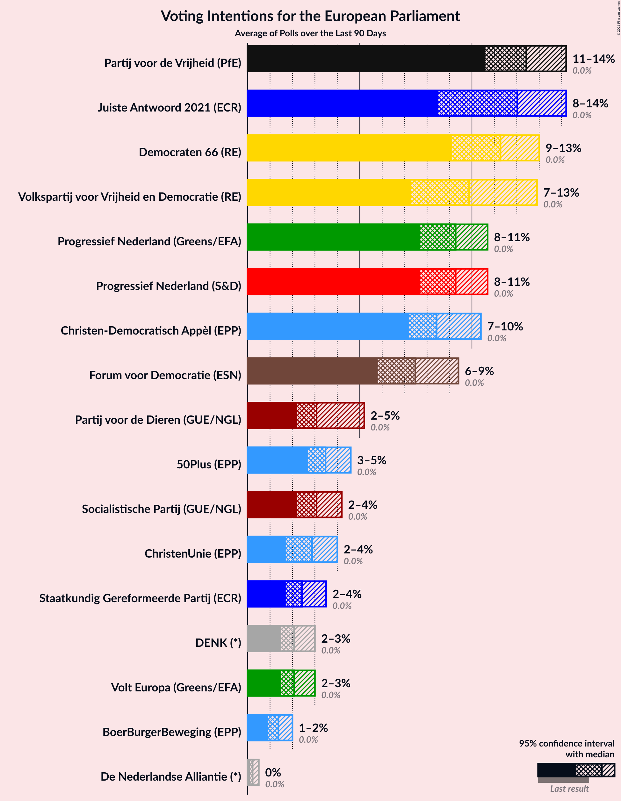
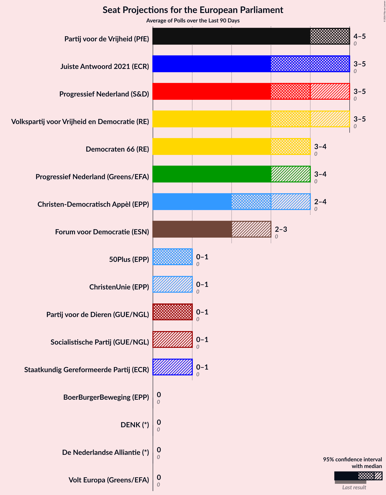
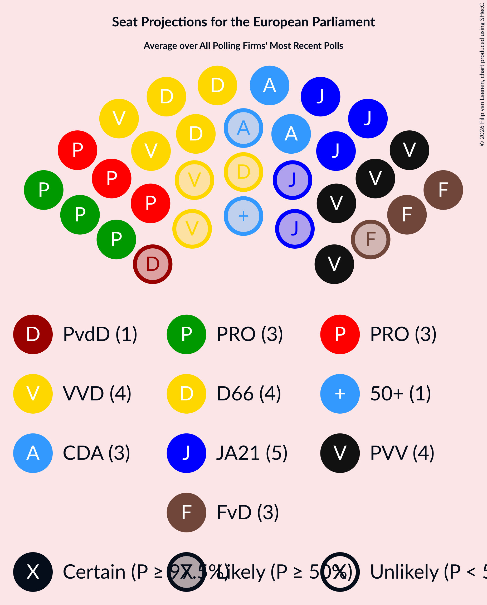
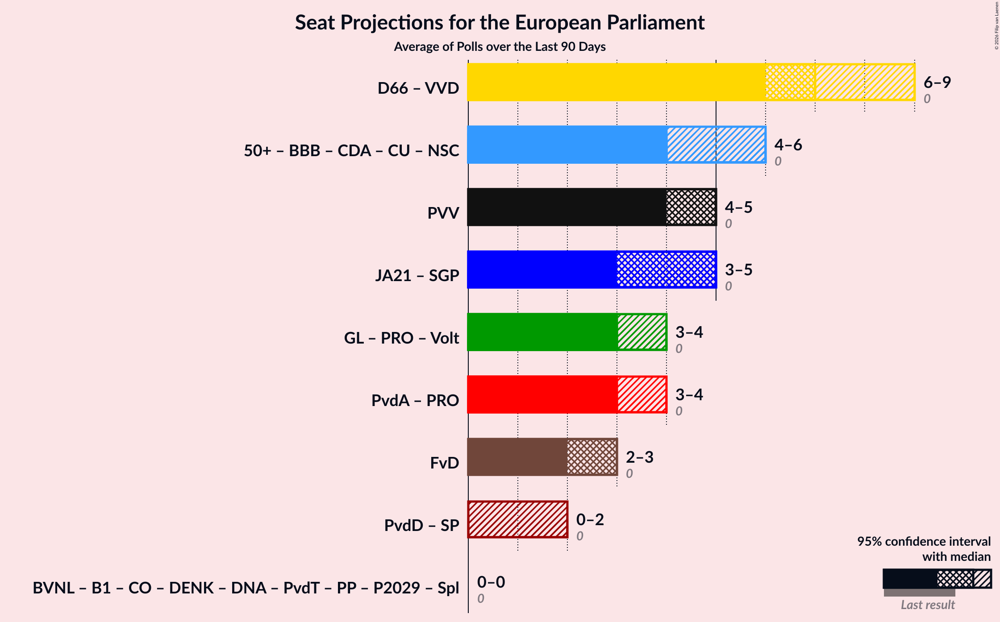

# Overview

The table below lists the most recent polls (less than 90 days old) registered and analyzed so far.

| Period     | Polling firm/Commissioner(s) | PvdD | SP | GL | PRO | Volt | PvdA | PRO | D66 | VVD | CDA | CU | 50+ | BBB | NSC | SGP | JA21 | PVV | FvD | BVNL | B1 | CO | DNA | DENK | PvdT | PP | P2029 | Spl |
|:----------:|:----------------------------:|:--:|:--:|:--:|:--:|:--:|:--:|:--:|:--:|:--:|:--:|:--:|:--:|:--:|:--:|:--:|:--:|:--:|:--:|:--:|:--:|:--:|:--:|:--:|:--:|:--:|:--:|:--:|
| 6 June 2024 | General Election | 0.0%   0 | 0.0%   0 | 0.0%   0 | 0.0%   0 | 0.0%   0 | 0.0%   0 | 0.0%   0 | 0.0%   0 | 0.0%   0 | 0.0%   0 | 0.0%   0 | 0.0%   0 | 0.0%   0 | 0.0%   0 | 0.0%   0 | 0.0%   0 | 0.0%   0 | 0.0%   0 | 0.0%   0 | 0.0%   0 | 0.0%   0 | 0.0%   0 | 0.0%   0 | 0.0%   0 | 0.0%   0 | 0.0%   0 | 0.0%   0 |
| N/A | [Poll Average](average.html) | 2–5%   0–1 | 2–4%   0–1 | N/A   N/A | 8–11%   3–4 | 2–3%   0–1 | N/A   N/A | 8–11%   3–5 | 9–13%   3–4 | 7–13%   2–5 | 7–10%   2–4 | 2–4%   0–1 | 3–5%   0–1 | 1–2%   0 | N/A   N/A | 2–4%   0–1 | 8–14%   3–5 | 11–14%   4–5 | 6–9%   2–3 | N/A   N/A | N/A   N/A | N/A   N/A | 0%   0 | 2–3%   0 | N/A   N/A | N/A   N/A | N/A   N/A | N/A   N/A |
| [23 October 2026](2026-10-23-Peilnl.html) | Peil.nl | 3–4%   0–1 | 3–4%   0–1 | N/A   N/A | 9–11%   3–4 | 2–3%   0–1 | N/A   N/A | 9–11%   3–5 | 10–12%   3–4 | 7–9%   2–3 | 6–8%   2–3 | 2–3%   0 | 3–4%   0–1 | 1–2%   0 | N/A   N/A | 2–3%   0 | 12–15%   4–5 | 11–14%   4–5 | 7–9%   2–3 | N/A   N/A | N/A   N/A | N/A   N/A | N/A   N/A | 2–3%   0 | N/A   N/A | N/A   N/A | N/A   N/A | N/A   N/A |
| [12–14 October 2026](2026-10-14-IpsosIO.html) | Ipsos I&O   Café Kockelmann | 4–6%   1 | 3–4%   0–1 | N/A   N/A | 8–11%   3–4 | 1–3%   0 | N/A   N/A | 8–11%   3–4 | 9–12%   3–4 | 9–11%   3–4 | 7–10%   3 | 2–4%   0–1 | 3–4%   0–1 | 1–2%   0 | N/A   N/A | 2–3%   0–1 | 11–14%   4–5 | 10–13%   4–6 | 6–8%   2–3 | N/A   N/A | N/A   N/A | N/A   N/A | 0–1%   0 | 1–3%   0 | N/A   N/A | N/A   N/A | N/A   N/A | N/A   N/A |
| [25–28 September 2026](2026-09-28-Verian.html) | Verian   EenVandaag | 2–4%   0–1 | 2–4%   0–1 | N/A   N/A | 7–11%   3–4 | 2–3%   0 | N/A   N/A | 7–11%   3–4 | 10–13%   3–4 | 10–13%   4–5 | 8–11%   3–4 | 2–4%   0–1 | 3–5%   0–2 | 1–2%   0 | N/A   N/A | 2–4%   0–1 | 8–11%   3–4 | 11–15%   4–5 | 6–8%   2–3 | N/A   N/A | N/A   N/A | N/A   N/A | N/A   N/A | 2–3%   0–1 | N/A   N/A | N/A   N/A | N/A   N/A | N/A   N/A |
| 6 June 2024 | General Election | 0.0%   0 | 0.0%   0 | 0.0%   0 | 0.0%   0 | 0.0%   0 | 0.0%   0 | 0.0%   0 | 0.0%   0 | 0.0%   0 | 0.0%   0 | 0.0%   0 | 0.0%   0 | 0.0%   0 | 0.0%   0 | 0.0%   0 | 0.0%   0 | 0.0%   0 | 0.0%   0 | 0.0%   0 | 0.0%   0 | 0.0%   0 | 0.0%   0 | 0.0%   0 | 0.0%   0 | 0.0%   0 | 0.0%   0 | 0.0%   0 |

Only polls for which at least the sample size has been published are included in the table above.

**Legend:**
+ **Top half of each row:** Voting intentions (95% confidence interval)
+ **Bottom half of each row:** Seat projections for the European Parliament (95% confidence interval)
+ **PvdD:** Partij voor de Dieren (GUE/NGL)
+ **SP:** Socialistische Partij (GUE/NGL)
+ **GL:** GroenLinks (Greens/EFA)
+ **PRO:** Progressief Nederland (Greens/EFA)
+ **Volt:** Volt Europa (Greens/EFA)
+ **PvdA:** Partij van de Arbeid (S&D)
+ **PRO:** Progressief Nederland (S&D)
+ **D66:** Democraten 66 (RE)
+ **VVD:** Volkspartij voor Vrijheid en Democratie (RE)
+ **CDA:** Christen-Democratisch Appèl (EPP)
+ **CU:** ChristenUnie (EPP)
+ **50+:** 50Plus (EPP)
+ **BBB:** BoerBurgerBeweging (EPP)
+ **NSC:** Nieuw Sociaal Contract (EPP)
+ **SGP:** Staatkundig Gereformeerde Partij (ECR)
+ **JA21:** Juiste Antwoord 2021 (ECR)
+ **PVV:** Partij voor de Vrijheid (PfE)
+ **FvD:** Forum voor Democratie (ESN)
+ **BVNL:** Belang van Nederland (*)
+ **B1:** Bij1 (*)
+ **CO:** Code Oranje (*)
+ **DNA:** De Nederlandse Alliantie (*)
+ **DENK:** DENK (*)
+ **PvdT:** Partij voor de Toekomst (*)
+ **PP:** Piratenpartij (*)
+ **P2029:** Project 2029 (*)
+ **Spl:** Splinter (*)
+ **N/A (single party):** Party not included the published results
+ **N/A (entire row):** Calculation for this opinion poll not started yet

